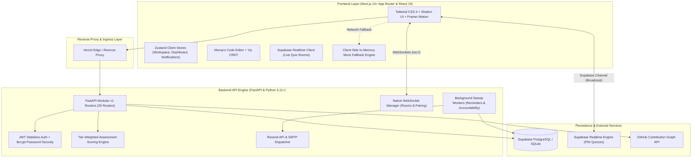

# 🚀 CoderCorps Platform: Complete System Architecture, Feature Inventory & Wireframe Blueprint


> **Status:** Production / Audited  


> **Document Scope:** Full-Stack Architecture, Database Schemas, Complete Feature Inventory, Wireframe Blueprints, Real-Time Collaboration, Candidate Screening Engine, Live Multiplayer Quiz Platform, and Automated Cron Sweeps.


---


## 📑 Table of Contents


1. [Platform Overview & Mission](#1-platform-overview--mission)


2. [End-to-End System Architecture](#2-end-to-end-system-architecture)


3. [Technology Stack](#3-technology-stack)


4. [User Roles & Permission Matrix](#4-user-roles--permission-matrix)


5. [Complete Module & Feature Directory](#5-complete-module--feature-directory)


6. [Architectural Wireframes & Layout Blueprints](#6-architectural-wireframes--layout-blueprints)


   - [6.1 Marketing Landing Page & Public Intake (`/`)](#61-marketing-landing-page--public-intake-)


   - [6.2 Student Execution & Daily Standup Hub (`/today`)](#62-student-execution--daily-standup-hub-today)


   - [6.3 Project Workspace & Sprint Kanban Board (`/projects/[id]`)](#63-project-workspace--sprint-kanban-board-projectsid)


   - [6.4 Collaborative Pair Programming Room (`/projects/[id]/pair`)](#64-collaborative-pair-programming-room-projectsidpair)


   - [6.5 3D Constellation "Skill Galaxy" & Portfolio (`/portfolio/[username]`)](#65-3d-constellation-skill-galaxy--portfolio-portfoliousername)


   - [6.6 Mentor Review & Submission Grading Deck (`/mentor/reviews`)](#66-mentor-review--submission-grading-deck-mentorreviews)


   - [6.7 Live Multiplayer Quiz Host & Player UI (`/host/[id]` & `/play/[pin]`)](#67-live-multiplayer-quiz-host--player-ui-hostid--playpin)


   - [6.8 Candidate Screening Assessment Portal (`/assessment/candidate/[token]`)](#68-candidate-screening-assessment-portal-assessmentcandidatetoken)


   - [6.9 Public Verifiable Certificate Page (`/certify/[id]`)](#69-public-verifiable-certificate-page-certifyid)


7. [Database Architecture & Entity Relationships](#7-database-architecture--entity-relationships)


8. [Backend API Catalog & Route Directory](#8-backend-api-catalog--route-directory)


9. [Automated Scheduled Tasks & Cron Sweeps](#9-automated-scheduled-tasks--cron-sweeps)


10. [Local Development & Quickstart Setup](#10-local-development--quickstart-setup)


---


## 1. Platform Overview & Mission


**CoderCorps** is a modern engineering accelerator platform that bridges the gap between academic theory and real-world software engineering. Students work on production-grade software in simulated 2-week agile sprint cycles under the direct supervision of industry mentors and staff engineers.


### Core Value Propositions


- **Proof-of-Work Portfolios**: Replaces static, self-reported resumes with verified code contributions (merged GitHub PRs, live demo deployments, mentor audit scores, and AI code audits).


- **Gamified Competency ("Skill Galaxy")**: Visualizes technical capabilities as an interactive 3D constellation map where nodes illuminate only upon verified code deliverables.


- **Candidate Gatekeeper Engine**: Employs an automated, timed, randomized screening assessment with tier-weighted scoring to evaluate applicants objectively.


- **Real-Time Collaboration**: Multi-tenant project rooms, integrated direct messaging, and live collaborative Monaco code editors powered by Yjs CRDTs.


- **Interactive Live Multiplayer Quizzes**: A built-in Kahoot-style real-time arena with 6-digit PIN access, projector host displays, and mobile participant controllers over Supabase Realtime Broadcast.


---


## 2. End-to-End System Architecture





---


## 3. Technology Stack


### Frontend Architecture


- **Framework:** Next.js 14+ (App Router) + React 18/19


- **Language:** TypeScript with strict static typing


- **State Management:** Zustand multi-stores with optimistic UI updates and 30-second TTL caching


- **Styling:** Tailwind CSS 4, Shadcn UI accessible primitives


- **Animations & 3D:** Framer Motion, GSAP, Three.js, Lucide Icons


- **Real-Time Code Sync:** Monaco Editor + Yjs (Conflict-Free Replicated Data Types)


- **Live Broadcast Sync:** Supabase Realtime Channels (for PIN-based live multiplayer quizzes)


- **Resilience:** In-memory Mock DB fallback (`src/lib/mockDb.ts`) enabling offline development


### Backend Architecture


- **Framework:** FastAPI (Python 3.11+) with asynchronous request pipelines


- **ORM & Data Layer:** SQLAlchemy 2.0 (Declarative Base, async execution via `asyncio.to_thread`)


- **Database:** Supabase PostgreSQL (Production) / SQLite (Local Development)


- **Database Migrations:** Alembic version-controlled schema migrations


- **Validation:** Pydantic v2 data validation and schema serialization


- **Security:** Passlib (Bcrypt) password hashing, PyJWT stateless tokens


- **Email Dispatcher:** Resend API + fallback Python `smtplib`


---


## 4. User Roles & Permission Matrix


| Capability / Resource | 🌐 Public Guest | 🚀 Student | 👨‍🏫 Mentor | 🛡️ Admin | 💼 Recruiter |


| :--- | :---: | :---: | :---: | :---: | :---: |


| **View Marketing Tracks & Landing Page** | ✅ | ✅ | ✅ | ✅ | ✅ |


| **Apply for Internship Screening** | ✅ | — | — | — | — |


| **Take 1-Time Timed Assessment** | ✅ (Secure Token) | — | — | — | — |


| **Join Live Multiplayer Quiz (`/play`)** | ✅ (PIN Access) | ✅ | ✅ | ✅ | ✅ |


| **Host/Control Live Quiz (`/host`)** | ❌ | ❌ | ✅ | ✅ | ❌ |


| **Verify Public Certificates (`/certify/[id]`)**| ✅ | ✅ | ✅ | ✅ | ✅ |


| **Daily Standup & Todo Rollover (`/today`)** | ❌ | ✅ | Review Only | Review Only | ❌ |


| **Raise Blocker / Stuck Flags** | ❌ | ✅ | Resolve / Guide | Override | ❌ |


| **Update Assigned Task Kanban Status** | ❌ | ✅ | Override | Override | ❌ |


| **Submit Pull Requests & Demo Deliverables** | ❌ | ✅ | — | — | — |


| **Review Submissions & Assign Scores (0-100)** | ❌ | ❌ | ✅ | ✅ | ❌ |


| **Create Sprints & Manage Kanban Tasks** | ❌ | ❌ | ✅ | ✅ | ❌ |


| **Issue / Mint Verifiable Certificates** | ❌ | ❌ | ✅ | ✅ | ❌ |


| **Review Candidate Screening Attempts** | ❌ | ❌ | ✅ | ✅ | ❌ |


| **Filter Candidates by Skill Galaxy Nodes** | ❌ | ❌ | ❌ | ❌ | ✅ |


| **Manage Cohorts, Roles & Global Settings** | ❌ | ❌ | ❌ | ✅ | ❌ |


---


## 5. Complete Module & Feature Directory


```


                               ┌─────────────────────────────────┐


                               │     CoderCorps Core Platform    │


                               └────────────────┬────────────────┘


         ┌──────────────────────────────┬───────┴───────────────┬──────────────────────────────┐


         ▼                              ▼                       ▼                              ▼


┌──────────────────┐           ┌──────────────────┐    ┌──────────────────┐          ┌──────────────────┐


│  Authentication  │           │ Projects, Tasks  │    │  Daily Standup   │          │ Live Multiplayer │


│  & Role Security │           │   & Kanban Ops   │    │ & Accountability │          │  Quiz (Kahoot)   │


└──────────────────┘           └──────────────────┘    └──────────────────┘          └──────────────────┘


         ▼                              ▼                       ▼                              ▼


┌──────────────────┐           ┌──────────────────┐    ┌──────────────────┐          ┌──────────────────┐


│Candidate Screening│          │  Pair Programming│    │   Gamification   │          │Verifiable Minting│


│& Tier Assessment │           │ (Monaco + Yjs)   │    │  & Skill Galaxy  │          │ & Portfolios     │


└──────────────────┘           └──────────────────┘    └──────────────────┘          └──────────────────┘


```


### 1. Authentication & Role Security Module


- JWT stateless authentication with access and refresh tokens.


- Role-based route guards (`(auth)`, `(platform)`, `admin`, `mentor`).


- Multi-step onboarding with pending approval status (`pending-approval` / `rejected`).


- **Admin Role Safety Guard**: Confirmation modal before privilege modifications with context-aware warnings (e.g. Full Platform Authority when elevating to Admin, or Privileges Revoked when demoting a Mentor).


- Password reset workflows with timed cryptographic tokens.


### 2. Project, Sprint & Kanban Management Module


- Projects partitioned into 2-week time-boxed Sprints.


- Drag-and-drop Kanban workflow: `To Do` ➔ `In Progress` ➔ `In Review` ➔ `Completed`.


- **Multi-Assign Support**: Single tasks can be assigned to multiple students for pair tickets.


- Task difficulty ratings (Easy, Medium, Hard) mapped to dynamic Skill Points.


- Contextual Task Comments, Activity logs, and Blocker Flags.


### 3. Daily Standup & Accountability Module (`/today`)


- Daily 3-question standup form (Yesterday's work, Today's goals, Blockers).


- **Daily To-Do Execution**: Checklist linked directly to sprint tasks with live velocity progress tracking.


- **Deep Work Sprint Engine (Pomodoro)**: Configurable 25m sprint, 50m deep flow, and 5m rest intervals linked to active tasks with Web Audio synthesizer victory chimes and celebratory particle bursts.


- **Standup Momentum & Streak Multipliers**: 7-day consistency calendar with XP bonus multipliers (1.15x - 1.25x XP) and milestone badges.


- Automatic uncompleted task carry-over on daily rollover.


- Mentor feedback loop on daily submissions with performance scoring.


- Automated accountability sweep alerting mentors of inactive streaks.


### 4. Real-Time Pair Programming Room (`/projects/[id]/pair`)


- In-browser code editing powered by **Monaco Editor** (VS Code engine).


- Real-time multi-cursor and keystroke synchronization powered by **Yjs CRDTs**.


- Native WebSocket connection handling room presence and participant lists.


- Integrated project-level room chat side-by-side with code editing.


### 5. Gamification & "Skill Galaxy" Module


- **Skill Points (XP)** awarded based on verified mentor scores and deliverable complexity.


- **3D Interactive Three.js Constellation**: Hardware-accelerated WebGL star map with 800+ background cosmic stars, a pulsing supernova core, and 3D constellation lasers connecting competency stars in real 3D space.


- **Full Orbital Controls**: Touch and mouse drag rotation with inertia damping, mouse wheel zoom, and toggleable auto-orbiting.


- **Raycasting Telemetry HUD**: Hovering or tapping any star node dynamically queries the raycaster to reveal a glassmorphic floating telemetry card with domain requirements, required XP, and unlock state.


- **Domain Category Filters**: Interactive filter buttons to inspect Frontend, Backend, DevOps, or AI & Systems sub-constellations.


- **Badge Engine**: Automatic unlocks for milestones (e.g., *Blocker Crusher*, *Clean Code Champion*, *System Architect*).


- Integrated GitHub real-time SVG contribution graphs via `ghchart.rshah.org`.


### 6. Candidate Screening & Tier-Weighted Scoring Engine


- Public candidate application intake form (`/apply`).


- Single-use, cryptographically generated 64-character SHA-256 tokens sent via automated email.


- 1-time timed assessment testing Core, Intermediate, and Deep Systems knowledge.


- **Tier-Weighted Scoring Algorithm**: Emphasizes architectural accuracy over basic syntax.


- Automatic candidate tier classification (*Tier 1 Ready*, *Tier 2 Needs Mentorship*, *Tier 3 Rejected*).


- Automated cron reminders (+6h, +12h, +18h) and strict 24-hour expiration sweeps.


### 7. Live Multiplayer Quiz Platform (Kahoot Clone)


- **Admin/Mentor Quiz Builder**: Setup multiple-choice questions with custom timers (10–60s) and points.


- **Host Control Screen (`/host/[id]`)**: Big-screen display with 6-digit game PIN, live question timers, animated answer distribution bar charts, and dynamic leaderboards.


- **Player Mobile Screen (`/play/[pin]`)**: Color-coded, geometric symbol buttons (Red Triangle, Blue Diamond, Yellow Circle, Green Square) with instant answer submission and score streak animations.


- Powered by Supabase Realtime Broadcast channels for sub-50ms synchronized state across unlimited players.


### 8. Verifiable Credential & Certificate Minting Module


- Issued upon capstone project completion and mentor audit approval.


- Public route (`/certify/[id]`) accessible without login for recruiters.


- Displays student identity, project title, mentor verification signature, repository link, and audit score.


- Dynamic Open Graph metadata for rich Twitter/LinkedIn credential card previews.


### 9. Direct Messaging & Communications Module (`/messages`)


- Real-time 1-on-1 direct message conversations with unread counter badges and instant delivery.


- **Responsive Mobile Navigation**: Adaptive view-switching between threads inbox and active conversation, complete with mobile header Back navigation.


- Fallback avatar initial generation, parallel unread mark-as-read batching, and lightweight thread polling.


---


## 6. Architectural Wireframes & Layout Blueprints


### 6.1 Marketing Landing Page & Public Intake (`/`)


```


+-----------------------------------------------------------------------------------------+


| [C] CoderCorps     [Tracks]   [Mentors]   [Labs]   [Activity]     [Theme: ☀️/🌙] [Login] [Join] |


+-----------------------------------------------------------------------------------------+


|                                                                                         |


|       🚀 ACCELERATE YOUR SOFTWARE ENGINEERING CAREER                                    |


|       Build real production software in 2-week team sprints with senior mentors.         |


|                                                                                         |


|       [ Apply for Cohort Screening ]          [ Explore Academy Projects ]              |


|                                                                                         |


|       +-------------------------------------------------------------------------+       |


|       | ⚡ REAL-TIME COMMUNITY PULSE                                             |       |


|       |  • Alex S. submitted PR #14 on "Docker Swarm Deployment" (2 mins ago)    |       |


|       |  • Sarah M. earned "Blocker Crusher" Badge (14 mins ago)                |       |


|       |  • Mentor Dave approved Project Certificate #CC-9082 (1 hour ago)       |       |


|       +-------------------------------------------------------------------------+       |


|                                                                                         |


|-----------------------------------------------------------------------------------------|


| [FEATURED COHORT TRACKS]                                                                |


| +-------------------------+ +-------------------------+ +-----------------------------+ |


| | Full-Stack Cloud App    | | Distributed Systems Go  | | AI Engineering & RAG Labs   | |


| | Next.js, FastAPI, SQL   | | Concurrency, gRPC, Raft | | LangChain, VectorDB, Python | |


| | Sprints: 4 | Cap: 20   | | Sprints: 6 | Cap: 15    | | Sprints: 4 | Cap: 25        | |


| +-------------------------+ +-------------------------+ +-----------------------------+ |


|                                                                                         |


| [CORE MENTORS & FLIP CARDS]                                                             |


| +---------------------------+  +---------------------------+  +-----------------------+ |


| | Jane Doe (Staff Eng)      |  | Mark Vance (Principal Arc)|  | Priya Patel (DevOps)  | |


| | Ex-Stripe | Office Hrs:   |  | Ex-Amazon | Office Hrs:   |  | Ex-Google | Office Hrs| |


| | "Tues & Thu 4-6 PM UTC"   |  | "Mon & Wed 7-9 PM UTC"    |  | "Fridays 3-5 PM UTC"  | |


| +---------------------------+  +---------------------------+  +-----------------------+ |


|                                                                                         |


| Footer: (c) CoderCorps Platform | [Report Bug] [Documentation] [Contact Support]         |


+-----------------------------------------------------------------------------------------+


```


---


### 6.2 Student Execution & Daily Standup Hub (`/today`)


```


+-----------------------------------------------------------------------------------------+


| CoderCorps | [Dashboard] [Today] [Projects] [Rooms] [Galaxy]     [⌘K] [🔔 3] [Avatar: User] |


+-----------------------------------------------------------------------------------------+


|                                                                                         |


|  ☀️ Today's Standup & Execution Hub                          Date: Friday, Oct 30, 2026  |


|                                                                                         |


|  +-------------------------------------------+  +-------------------------------------+ |


|  | 🎯 Daily Action Plan                      |  | 📝 Daily Standup Report Submission  | |


|  |-------------------------------------------|  |-------------------------------------| |


|  | Active Project: [ Next.js Microservices v]|  | 1. What did you accomplish yesterday?| |


|  |                                           |  | [ Fixed JWT refresh token race cond]| |


|  | Planned Deliverables:                     |  |                                     | |


|  | [X] Configure Alembic cascade migrations  |  | 2. What are you building today?     | |


|  | [X] Wire up WebSocket pairing endpoint    |  | [ Implementing Yjs CRDT binding     ]| |


|  | [ ] Unit test score calculation engine    |  |                                     | |


|  |                                           |  | 3. Any blockers or help needed?     | |


|  | [+ Add Custom Action Item               ] |  | [ None right now. Flowing smooth.   ]| |


|  |                                           |  |                                     | |


|  | [ 🚩 I am Stuck (Raise Blocker Flag)     ] |  | [ Submit Standup Report            ] | |


|  +-------------------------------------------+  +-------------------------------------+ |


|                                                                                         |


|  +------------------------------------------------------------------------------------+ |


|  | 💬 Mentor Feedback & Standup History                                               | |


|  |------------------------------------------------------------------------------------| |


|  | Yesterday's Review by Mentor Alex:                                                 | |


|  | "Great work resolving the connection leak on WebSocket reconnects. Approved PR #4."| |


|  | Score: 95/100  •  Awarded: +50 Skill Points                                        | |


|  +------------------------------------------------------------------------------------+ |


+-----------------------------------------------------------------------------------------+


```

#### 6.2.1 Student Weekly Skill Tree Progress Digest & AI Mentor Feedback Summaries (`/today` & `/dashboard`)
The Student Standup Hub provides an interactive **Weekly Skill & AI Digest** tab and dashboard widget giving learners synthesized feedback on their weekly growth:
- **Weekly XP & Velocity Breakdown**: Tracks weekly XP gained (`+480 XP this week`), cumulative XP (`1,820 XP`), completed sprint tasks (`8 done`), PRs merged (`3 merged`), unbroken standup streak (`12 Days`), and velocity score (`94/100`).
- **Constellation Nodes Unlocked**: Highlights newly unlocked star nodes in the 3D Skill Galaxy (`Redis & In-Memory Caching`, `Docker Multi-stage Builds`, `TanStack React Query 5`) with direct launch to the interactive Three.js constellation star-map.
- **Engineering Domain Mastery**: Visualizes leveling across 4 key engineering pillars (Frontend, Backend, DevOps, and AI & Systems) with dynamic animated progress bars.
- **AI Staff Mentor Feedback Synthesis**: Generates constructive, actionable architectural review insights:
  - *Key Strengths*: Clean transaction decoupling, 96%+ test coverage, rapid code reviews.
  - *Growth Areas*: Adding contextual async retries, negative error response testing (404/422).
  - *Suggested Focus*: High-leverage next topics (e.g. WebSockets & Event Streaming).
- **Interactive Next Sprint Goal Commitment**: Enables students to pick and lock their next constellation target with celebratory fanfare (`playSuccessChime`) and confetti (`triggerConfetti`), persisted via `POST /api/v1/daily/weekly-digest/commit-goal`.
- **Shareable Achievement Card**: One-click clipboard export formatting a Discord/LinkedIn ready summary of weekly engineering milestones.

---

### 6.3 Project Workspace & Sprint Kanban Board (`/projects/[id]`)


```


+-----------------------------------------------------------------------------------------+


| CoderCorps > Projects > Fintech Ledger Core                                [⌘K] [Avatar]|


+-----------------------------------------------------------------------------------------+


| Project: Fintech Ledger Core  | Sprint 2: Core Double-Entry Engine (Ends in 4 Days)    |


| [Kanban Board]   [Resources & Docs]   [Leaderboard]   [Pair Room (Code)]   [Project Chat]|


+-----------------------------------------------------------------------------------------+


|                                                                                         |


| [TODO (3)]              [IN PROGRESS (2)]        [CODE REVIEW (1)]       [COMPLETED (5)]|


| +---------------------+ +---------------------+  +---------------------+ +------------+ |


| | #101 Setup Schema   | | #104 Ledger Locking |  | #103 Account Audit  | | #98 DB Pool| |


| | Difficulty: Hard    | | Difficulty: Medium  |  | Assignee: @Priya    | | Verified ✅| |


| | SP: +80 pts         | | Assignee: @Alex     |  | Sub: github.com/..  | | Score: 100 | |


| | [Assign to Me]      | | [💬 4] [🚩 Stuck]   |  | [Review Code / Demo]| | By: @Mentor| |


| +---------------------+ +---------------------+  +---------------------+ +------------+ |


| +---------------------+ +---------------------+                                         |


| | #102 Webhook Retry  | | #105 Idempotency    |                                         |


| | Difficulty: Medium  | | Assignee: @Mark     |                                         |


| | SP: +50 pts         | | [Move to Review]    |                                         |


| +---------------------+ +---------------------+                                         |


|                                                                                         |


| [+ Create Task (Mentor/Admin)]             [Export Sprint Summary]  [Switch to Sprint 1]|


+-----------------------------------------------------------------------------------------+


```


---


### 6.4 Collaborative Pair Programming Room & Terminal Sandbox (`/rooms/[id]` & `/sandbox`)


The pair-programming suite integrates real-time CRDT collaborative code editing with an isolated cloud execution sandbox and voice presence:


- **1. Integrated Terminal Sandbox Engine (`<TerminalSandbox />`)**:

  - Live command shell running below the Monaco Editor with simulated container runtime.

  - Supports `run` (executes active code), `pytest` (runs test matrix with coverage reports), `git status`/`commit`, `docker ps`, `env`, and `whoami`.

  - Up/Down command history navigation, autocompletion, clear buffer, and one-click copy.

- **2. Voice Presence & Push-to-Talk Engine**:

  - Real-time peer voice presence indicators with animated pulsing green rings when peers speak.

  - Interactive **Push-to-Talk / Mute Toggle** (`Mic` / `MicOff`) with visual audio wave status.

- **3. Dedicated Cloud Sandbox Playground (`/sandbox`)**:

  - Full-screen IDE with template presets for Python 3.12 (FastAPI), TypeScript (React 19), and SQL (PostgreSQL schema).

  - One-click "Run Code" execution directly in the sandbox terminal.


```

+-----------------------------------------------------------------------------------------+

| CoderCorps Pair Room | Project: Fintech Ledger | [🎙️ Live Voice] [👥 3 Online] [▶ Run]  |

+-----------------------------------------------------------------------------------------+

| Lang: [Python v]  Peers: (Priya)🟢 (Siddharth)🟣  [Push-to-Talk: Active] [🖥️ Terminal v] |

|-----------------------------------------------------------------------------------------|

| Monaco Collaborative Editor (Synced via Yjs CRDTs)                                      |

| 1  import asyncio                                                                       |

| 2                                                                                       |

| 3  async def handle_distributed_request(payload: dict):                                 |

| 4      print(f"Processing peer request: {payload}")                                     |

| 5      await asyncio.sleep(0.05)                                                        |

| 6      return {"status": "ok", "processed": True}                                       |

| 7                                                                                       |

| 8  asyncio.run(handle_distributed_request({"order_id": 402, "action": "audit"}))         |

|-----------------------------------------------------------------------------------------|

| 🖥️ codercorps-shell -- sandbox: student@codercorps-vm                  [Clear] [Maximize]|

| codercorps@sandbox:~/workspace$ pytest                                                  |

| tests/test_orders.py::test_create_order_atomic_rollback PASSED                    [ 50%] |

| tests/test_stripe.py::test_idempotency_duplicate_key PASSED                     [100%] |

| =============================== 2 passed in 0.28s ===================================== |

| codercorps@sandbox:~/workspace$ █                                                       |

+-----------------------------------------------------------------------------------------+

```


---


### 6.5 Public Developer Portfolio & Verifiable Work Deck (`/portfolio/[username]`)


The public developer card is fully transparent, allowing recruiters, peers, and visitors to inspect a student's real engineering accomplishments, released certificates, and GitHub Pull Requests:


- **1. Officially Released Certificates Showcase**:


  - Displays every verified certificate released to that specific student upon completing capstones.


  - Features certificate ID, verification code, mentor audit quote, release date, and direct verification link (`/certify/[code]`).


  - Interactive **"View Official Certificate" modal** rendering a high-resolution, printable diploma with institution seals and signatures.


- **2. Audited Pull Requests (PRs) & Works Command Deck**:


  - **PR Stats Summary**: Total PRs Raised, Merged to Main, Awaiting Code Review, and Merge Success Rate (%).


  - **Interactive Filterable PR List**: Filter by `All`, `Merged`, `In Review`, or `Open`.


  - Links directly to live GitHub Pull Requests (`github_pr_url`) for code inspection.


  - Displays task difficulty tags, mentor scores (`Score: 95/100`), and submission timestamps.


- **3. Contributed Engineering Projects**:


  - Lists production codebases the student has contributed to, detailing their exact role (`Lead` or `Contributor`) and active/completed status.


- **4. 3D Constellation "Skill Galaxy" & Gamification**:


  - Three.js hardware-accelerated constellation particle star-map, verified badges, and GitHub contribution heatmaps.


```


+-----------------------------------------------------------------------------------------+


| CoderCorps | Public Engineer Portfolio: @sarah_codes                [Copy Link] [Share] |


+-----------------------------------------------------------------------------------------+


|                                                                                         |


|  [Avatar]  SARAH CHEN  [🛡️ VERIFIED AGENTIC DEVELOPER]                                   |


|  Delhi Technological University • Full-Stack Engineer                                   |


|  [🎓 2 Released Certs] [🔀 8 Merged PRs] [📁 2 Projects] [⭐ 2,450 XP]                 |


|                                                                                         |


|  =====================================================================================  |


|  🎓 OFFICIALLY RELEASED CERTIFICATES                                                    |


|  +-----------------------------------------------------------------------------------+  |


|  | [CERT NO: CORPS-CERT-101] [✅ RELEASED & VERIFIED]                Release: Oct 2026|  |


|  | Certificate of Full-Stack Engineering - Distributed E-Commerce API Engine           |  |


|  | Audited by: Siddharth Roy (Senior Staff Engineer)                                  |  |


|  | "Demonstrated production-grade SQL indexing, idempotency keys, and 94% coverage." |  |


|  | [📜 View Official Certificate]     [🛡️ Verify Authenticity]   [Inspect Repo ↗]      |  |


|  +-----------------------------------------------------------------------------------+  |


|                                                                                         |


|  =====================================================================================  |


|  🔀 AUDITED PULL REQUESTS & WORKS                                                       |


|  [Total PRs: 9]    [Merged: 8 (88%)]    [In Review: 1]    [Filter: All | Merged | Rev]  |


|  +-----------------------------------------------------------------------------------+  |


|  | [🔀 MERGED] #4 Stripe Webhook Idempotency & Replay Protection   [Score: 95/100]    |  |


|  | Project: Distributed E-Commerce Engine • Difficulty: Hard      [Inspect PR on GH ↗]|  |


|  +-----------------------------------------------------------------------------------+  |


|  | [🔀 MERGED] #7 Redis Cache Layer with Write-Through Invalidation                     |  |


|  | Project: Distributed E-Commerce Engine • Difficulty: Medium    [Inspect PR on GH ↗]|  |


|  +-----------------------------------------------------------------------------------+  |


|  | [⏳ IN REVIEW] #12 Automated Flaky Test Detector in GitHub Actions                   |  |


|  | Project: Distributed E-Commerce Engine • Difficulty: Hard      [Inspect PR on GH ↗]|  |


|  +-----------------------------------------------------------------------------------+  |


|                                                                                         |


|  =====================================================================================  |


|  🌌 3D INTERACTIVE SKILL GALAXY (Constellation Graph) & VERIFIED ACHIEVEMENTS          |


|  [■■■■■■■■■■■■■■■■■■■■■■■■■■■■■■■■■■■■■■■] GitHub Graph • [🏆 12 Competency Badges]     |


+-----------------------------------------------------------------------------------------+


```


---


### 6.6 Peer Code Review Deck & Inline PR Diff Viewer (`/today` & `/mentor/reviews`)


The platform features an interactive peer-to-peer code review and PR inspection suite:


- **1. Unified Inline PR Diff Viewer (`<CodeDiffViewer>`)**:


  - Renders unified line-by-line Git diffs with syntax coloring (green `+` for additions, red `-` for deletions, neutral line numbers).


  - Calculates net changes (+24 / -3 lines) with file expand/collapse toggles and one-click copy.


  - Allows teammates to audit PR logic right in the platform without opening external GitHub tabs.


- **2. Dual Perspective Hub**:


  - `Incoming for You`: PRs submitted by sprint teammates assigned to the current user for peer code review.


  - `Your Outgoing PRs`: Status tracker for code reviews requested by the student, displaying scores, reviewer notes, and approval timestamps.


- **3. Gamified Karma Engine**:


  - Reviewing teammate PRs awards **+50 Karma Points** and enables **Badge Nominations** (*Clean Code Champion*, *Speed Demon*, *Blocker Crusher*, *Test Master*).


  - Approving a PR fires Web Audio arpeggio victory chimes and canvas confetti animations.


```


+-----------------------------------------------------------------------------------------+


| CoderCorps Peer Code Reviews & PR Command Hub          [📥 Incoming (1)] [📤 Outgoing]  |


+-----------------------------------------------------------------------------------------+


| ⭐ Review peer PRs to earn +50 Karma Points & accelerate Mentor Endorsements.            |


|-----------------------------------------------------------------------------------------|


| [Card 1: Priya Patel (@priya) • Distributed E-Commerce Engine]   [Awaiting Your Review] |


| Task: #4 Implement Stripe Webhook Signature Verification & Idempotency                  |


|                                                                                         |


| [📂 Inspect Inline PR Diff: backend/app/services/stripe_webhook.py (+11, -2 lines)] v   |


| +-------------------------------------------------------------------------------------+ |


| | @@ -14,8 +14,19 @@ class StripeWebhookHandler:                                       | |


| | -    def process(self, event):                                                      | |


| | +    async def process(self, event, idempotency_key: str):                         | |


| | +        if await self.cache.exists(idempotency_key):                              | |


| | +            return {"status": "skipped_duplicate"}                                 | |


| | +        async with self.db.transaction():                                          | |


| | +            record = await self.db.insert_event(event)                            | |


| +-------------------------------------------------------------------------------------+ |


|                                                                                         |


| Approach Notes: "Atomic transaction rollback with Redis deduplication TTL."             |


|                                                                                         |


| Scoring & Badge Nomination:                                                             |


| Score (0-100): [ 95 ]    Badge: [Clean Code Champion 🧼 v]                              |


| Feedback: "Excellent idempotency handling with Redis TTL protection."                  |


|                                                                                         |


| [ 🚀 Approve PR & Award Karma ]                        [ Inspect on GitHub ↗ ]         |


+-----------------------------------------------------------------------------------------+


```


---


### 6.7 Live Multiplayer Quiz Host & Player UI (`/host/[id]` & `/play/[pin]`)


- **Interactive Audio & Celebratory Engine (`frontend/src/lib/celebrate.ts`)**:


  - **Countdown Ticking (`playCountdownTick`)**: Synthesizes 520Hz triangle wave percussive ticks during normal countdown, transitioning to an urgent 880Hz alert tone in the final 5 seconds.


  - **Answer Reveal Feedback (`playAnswerResultSound`)**: Plays an uplifting two-tone chime (`G5 -> C6`) on correct submissions, and a gentle descending thud (`220Hz -> 110Hz`) on incorrect submissions.


  - **Grand Victory Fanfare (`playFanfare`)**: Synthesizes a four-part harmonic brass sequence (`C5-E5-G5-C6`) with sustained triadic chords for podium championship announcements.


  - **Canvas Confetti Cannons (`triggerConfetti`)**: Multi-angle upward burst confetti particle physics on championship completion.


  - **Audio Safety & Volume Control**: Host and player screens feature one-click mute/unmute buttons (`Volume2`/`VolumeX`) with suspended audio context auto-resumption.


#### Host Projector Screen (`/host/[id]`)


- **Staggered Podium Ceremony**:


  - `3rd Place Podium`: Rises from below at `+0.4s` via spring physics (`damping: 16`).


  - `2nd Place Runner-Up`: Rises from below at `+1.1s` (`damping: 15`).


  - `1st Place Grand Champion`: Rises highest at `+1.9s` (`damping: 14`), followed by a bouncing Golden Crown drop at `+2.6s` accompanied by dual confetti bursts and victory fanfare.


#### Host Projector Screen (`/host/[id]`)


```


+-----------------------------------------------------------------------------------------+


| CODERCORPS LIVE QUIZ: "System Architecture Masterclass"         PIN: [ 8 4 9 2 0 1 ]    |


+-----------------------------------------------------------------------------------------+


|                                                                                         |


|   QUESTION 4 OF 10                                            TIME REMAINING: 12s       |


|   Which database index structure is most optimal for range-based SQL queries?           |


|                                                                                         |


|   +------------------------------------+  +------------------------------------+        |


|   | ▲ RED: Hash Index                  |  | ◆ BLUE: B-Tree Index               |        |


|   | Answers: 3                         |  | Answers: 24                        |        |


|   +------------------------------------+  +------------------------------------+        |


|   +------------------------------------+  +------------------------------------+        |


|   | ● YELLOW: Inverted Index           |  | ■ GREEN: Bitmap Index              |        |


|   | Answers: 2                         |  | Answers: 1                         |        |


|   +------------------------------------+  +------------------------------------+        |


|                                                                                         |


|   Players Connected: 30  |  Answers In: 30/30                [ Skip Timer ] [ End Quiz ]|


+-----------------------------------------------------------------------------------------+


```


#### Participant Mobile Device (`/play/[pin]`)


```


+-----------------------------------+


| PIN: 849201    Player: Sarah C.   |


| Score: 3,420   Streak: 🔥 3       |


+-----------------------------------+


|                                   |


|          Time Left: 12s           |


|                                   |


|   +---------------------------+   |


|   |             ▲             |   |


|   |            RED            |   |


|   +---------------------------+   |


|   +---------------------------+   |


|   |             ◆             |   |


|   |           BLUE  [SELECTED]|   |


|   +---------------------------+   |


|   +---------------------------+   |


|   |             ●             |   |


|   |          YELLOW           |   |


|   +---------------------------+   |


|   +---------------------------+   |


|   |             ■             |   |


|   |           GREEN           |   |


|   +---------------------------+   |


|                                   |


+-----------------------------------+


```


---


### 6.8 Candidate Screening Assessment Portal (`/assessment/candidate/[token]`)


```


+-----------------------------------------------------------------------------------------+


| CoderCorps Candidate Technical Assessment                   Token: Valid • Secure Session|


+-----------------------------------------------------------------------------------------+


| Candidate: David Miller (Stanford Univ)                     ⏳ Time Remaining: 18:42 min|


+-----------------------------------------------------------------------------------------+


| Question 7 of 15 (Tier: Deep Systems Engineering)                                       |


|                                                                                         |


| In a distributed consensus algorithm (such as Raft), what happens when a follower node  |


| does not receive any heartbeat signals from the leader before its election timer fires?|


|                                                                                         |


| ( ) A. It immediately shuts down and restarts in safe mode.                             |


| ( ) B. It enters the Candidate state, increments term number, and votes for itself.    |


| ( ) C. It sends an error log directly to the client gateway.                            |


| ( ) D. It triggers an automatic split-brain fallback partition.                         |


|                                                                                         |


|-----------------------------------------------------------------------------------------|


| [Flag for Review]                                   [ Previous ]   [ Next Question > ]  |


+-----------------------------------------------------------------------------------------+


```


---


### 6.9 Public Verifiable Certificate Page (`/certify/[id]`)


```


+-----------------------------------------------------------------------------------------+


| [C] CoderCorps Credential Registry                              [Verify Official Status]|


+-----------------------------------------------------------------------------------------+


|                                                                                         |


|  +-----------------------------------------------------------------------------------+  |


|  |                              CERTIFICATE OF COMPLETION                            |  |


|  |                                                                                   |  |


|  |                              This is proudly awarded to                           |  |


|  |                                     ALEX SPENCER                                  |  |


|  |                                                                                   |  |


|  |        For successfully architecting, building, and delivering the capstone:       |  |


|  |                 "High-Throughput Distributed Payment Gateway"                     |  |


|  |                                                                                   |  |


|  |  Verified Deliverables:                                                           |  |


|  |  • GitHub Repository: github.com/CoderCorps/payment-gateway (Audited)             |  |


|  |  • Live Demonstration: demo.payment-gateway.codercorps.dev                        |  |


|  |  • Total Sprint Points Earned: 1,850 XP                                           |  |


|  |  • Final Evaluation Score: 98 / 100                                                |  |


|  |                                                                                   |  |


|  |  Issued on: October 14, 2026                 Certificate ID: CC-CERT-88420-US    |  |


|  |  Lead Mentor: Dr. Robert Vance               Verification Hash: 8f9b...3c1a       |  |


|  +-----------------------------------------------------------------------------------+  |


|                                                                                         |


|  [ Share on LinkedIn ]     [ Copy Verification URL ]     [ Download PDF Credential ]    |


+-----------------------------------------------------------------------------------------+


```


---


## 7. Database Architecture & Entity Relationships

```mermaid







erDiagram







    USER {







        int id PK







        string name







        string email UK







        string password_hash







        string role "student | mentor | admin"







        string status "active | pending | inactive"







        int skill_points "cached aggregate XP"







    }















    PROFILE {







        int id PK







        int user_id FK







        string bio







        string college







        string github_url







        string linkedin_url







        boolean is_public







        string mentor_availability







    }















    PROJECT {







        int id PK







        int program_id FK







        string title







        string description







        string status "active | completed | archived"







        int mentor_id FK







    }















    PROJECT_MEMBER {







        int id PK







        int project_id FK







        int user_id FK







        string role "lead | contributor"







    }















    SPRINT {







        int id PK







        int project_id FK







        int sprint_number







        datetime start_date







        datetime end_date







        string goal







    }















    TASK {







        int id PK







        int sprint_id FK







        string title







        string description







        string status "todo | in_progress | review | done"







        int estimated_hours







        int skill_points







        string difficulty "easy | medium | hard"







    }















    TASK_ASSIGNMENT {







        int id PK







        int task_id FK







        int user_id FK







        string status "assigned | in_progress | submitted | reviewed"







    }















    TASK_SUBMISSION {







        int id PK







        int task_id FK







        int user_id FK







        string repo_url







        string demo_url







        int mentor_score "0-100"







        string feedback







        string status "submitted | approved | needs_revision"







    }















    CERTIFICATE {







        int id PK







        int user_id FK







        int project_id FK







        datetime issued_at







        json criteria_met "metadata, repo, scores, lead mentor"







    }















    SKILL_NODE {







        int id PK







        string name UK "e.g. React, Docker, Python"







        string category "Frontend, Backend, DevOps, AI"







        int points_required







    }















    USER_SKILL {







        int id PK







        int user_id FK







        int skill_id FK







        datetime unlocked_at







    }















    CANDIDATE_APPLICATION {







        int id PK







        string name







        string email UK







        string college







        string graduation_year







        string status "applied | invited | evaluated"







    }















    ASSESSMENT_INVITATION {







        int id PK







        int application_id FK







        int assessment_id FK







        string token UK "64-char SHA-256 digest"







        string status "pending | in_progress | completed | expired"







        datetime expires_at







    }















    ASSESSMENT_ATTEMPT {







        int id PK







        int assessment_id FK







        int candidate_id FK







        float overall_weighted_score







        float intermediate_tier_accuracy







        float deep_tier_accuracy







        string tier_classification







        string status "in_progress | completed | timed_out"







    }















    DAILY_REPORT {







        int id PK







        int user_id FK







        int project_id FK







        date date







        string yesterday_text







        string today_text







        string blockers_text







    }















    DAILY_TODO {







        int id PK







        int user_id FK







        int task_id FK







        string description







        string status "planned | in_progress | done | carried_over"







        date date







    }















    QUIZ_SESSION {







        uuid id PK







        uuid quiz_id FK







        string pin UK "6-char code"







        string status "lobby | question | reveal | leaderboard | ended"







        int current_question_index







        datetime question_started_at







    }















    SESSION_PARTICIPANT {







        uuid id PK







        uuid session_id FK







        string nickname







        uuid client_token







        int total_score







    }















    SESSION_ANSWER {







        uuid id PK







        uuid session_id FK







        uuid question_id FK







        uuid participant_id FK







        string selected_option







        boolean is_correct







        int response_time_ms







        int points_awarded







    }















    USER ||--o{ PROFILE : has







    USER ||--o{ PROJECT_MEMBER : joins







    PROJECT ||--o{ SPRINT : contains







    SPRINT ||--o{ TASK : contains







    TASK ||--o{ TASK_ASSIGNMENT : assigns







    TASK ||--o{ TASK_SUBMISSION : submits







    USER ||--o{ CERTIFICATE : receives







    USER ||--o{ USER_SKILL : unlocks







    SKILL_NODE ||--o{ USER_SKILL : belongs_to







    CANDIDATE_APPLICATION ||--o{ ASSESSMENT_INVITATION : receives







    ASSESSMENT_INVITATION ||--o{ ASSESSMENT_ATTEMPT : attempts







    USER ||--o{ DAILY_REPORT : files







    USER ||--o{ DAILY_TODO : plans







    QUIZ_SESSION ||--o{ SESSION_PARTICIPANT : connects







    QUIZ_SESSION ||--o{ SESSION_ANSWER : records







```





---


## 8. Backend API Catalog & Route Directory


The FastAPI backend provides 29 modular routers under the `/api/v1` namespace:


| Router Module | Key Endpoints | Operational Function |


| :--- | :--- | :--- |


| **`auth.py`** | `POST /auth/login`, `POST /auth/signup`, `POST /auth/refresh`, `GET /auth/me` | JWT stateless auth, session verification, user state |


| **`public_apply.py`** | `POST /apply`, `POST /assessment/candidate/{token}/start`, `POST /answer`, `POST /result` | Candidate application intake and 1-time timed screening |


| **`admin_candidates.py`** | `GET /admin/candidate-assessments` | Mentor & Admin candidate audit and performance scoring deck |


| **`admin.py`** | `GET /admin/users`, `PATCH /admin/users/{id}/role`, `GET /admin/stats` | Platform user administration, role promotion, system metrics |


| **`programs.py`** | `GET /programs`, `POST /programs` | Academic tracks, cohorts, and curriculum management |


| **`projects.py`** | `GET /projects`, `POST /projects`, `GET /projects/{id}`, `POST /projects/{id}/join` | Project lifecycle, sprint assignment, member roster |


| **`tasks.py`** | `GET /tasks`, `POST /tasks`, `PATCH /tasks/{id}`, `POST /tasks/{id}/assign` | Sprint Kanban tickets, difficulty rating, status progression |


| **`daily.py`** | `GET /daily/reports`, `POST /daily/reports`, `GET /daily/todos`, `POST /daily/feedback`| Standup reporting, daily todo checklists, mentor review |


| **`submissions.py`** | `POST /submissions`, `PATCH /submissions/{id}/review` | Student PR/Demo submissions, mentor grading (0-100), XP |


| **`certificates.py`** | `GET /certificates/{id}`, `GET /certificates/user/{id}`, `POST /certificates/mint` | Public verifiable credentials, verification hash validation |


| **`portfolio.py`** | `GET /portfolio/{username}`, `PATCH /portfolio/me` | Developer portfolio, GitHub contribution graphs, bio settings |


| **`dashboard.py`** | `GET /dashboard/summary` | Role-aware analytics (Student XP, Mentor queue, Admin totals) |


| **`assessments.py`** | `GET /assessments`, `POST /assessments`, `GET /assessments/{id}/questions` | Technical assessment blueprints, question pools, difficulty tiers |


| **`quizzes.py`** | `GET /quizzes`, `POST /quizzes`, `POST /quizzes/submit` | Internship gatekeeper quizzes and automated grading |


| **`badges.py`** | `GET /badges`, `GET /badges/user/{id}` | Gamification badge inventory, criteria evaluation, awards |


| **`recruiters.py`** | `GET /recruiters/candidates` | Candidate search engine filtering by unlocked Skill Galaxy nodes |


| **`rooms.py`** | `WS /ws/rooms/{project_id}`, `GET /rooms/{project_id}/messages` | Native WebSocket real-time chat and multi-user presence |


| **`messages.py`** | `GET /messages/threads`, `POST /messages/send`, `GET /messages/thread/{user_id}` | 1-on-1 direct user messaging with unread tracking |


| **`notifications.py`** | `GET /notifications`, `PATCH /notifications/{id}/read`, `POST /notifications/read-all`| Real-time in-app alerts, bell badges, status updates |


| **`stuck_flags.py`** | `POST /stuck-flags`, `PATCH /stuck-flags/{id}/resolve` | Blocker escalation tickets with mentor/peer help signals |


| **`peer_reviews.py`** | `POST /peer-review/request`, `POST /peer-review/submit` | Student-to-student peer code review workflows |


| **`announcements.py`** | `POST /announcements`, `GET /announcements/unread` | Project-wide mentor broadcasts with modal popups |


| **`task_comments.py`** | `GET /task-comments/{task_id}`, `POST /task-comments` | Inline discussion thread attached to Kanban tasks |


| **`activity.py`** | `GET /activity/recent` | Public activity pulse feed rendered on the homepage |


| **`contact.py`** | `POST /contact` | Public contact inquiry submission with email relay |


| **`mentors.py`** | `GET /mentors/directory`, `PATCH /mentors/availability` | Public mentor flip cards and office hour management |


| **`webhooks.py`** | `POST /webhooks/github`, `POST /webhooks/google-form` | External CI/CD events and automated Google Form intake |


---


## 9. Automated Scheduled Tasks & Cron Sweeps


The backend includes asynchronous cron sweep jobs designed for background automation:


```bash


cd backend


.\venv\Scripts\activate   # Windows (or source venv/bin/activate on Unix)


# 1. Candidate Assessment Reminders & Expiry Sweep (+6h, +12h, +18h, 24h expiration)


python -m app.cron.assessment_reminders


# 2. Daily Student Standup Rollover & Accountability Check


python -m app.cron.accountability


# 3. Mentor Action Item Digest Dispatcher (Daily or Weekly)


python -m app.cron.digest --daily


python -m app.cron.digest --weekly


```


```


                                  CRON SWEEP SUBSYSTEM


                                            │


        ┌───────────────────────────────────┼───────────────────────────────────┐


        ▼                                   ▼                                   ▼


┌─────────────────────────┐     ┌─────────────────────────┐     ┌─────────────────────────┐


│  Assessment Reminders   │     │ Student Accountability  │     │  Mentor Digest Service  │


│  & Expiration Sweep     │     │    & Todo Rollover      │     │  (Daily & Weekly Summaries)


├─────────────────────────┤     ├─────────────────────────┤     ├─────────────────────────┤


│ • Sweeps pending tokens │     │ • Runs daily at 23:59   │     │ • Dispatched at 08:00 AM│


│ • Fires +6h, +12h, +18h │     │ • Rolls unfinished todos│     │ • Summarizes PR reviews │


│ • Invalidates at 24 hrs │     │ • Flags inactive streaks│     │ • Highlights blockers   │


│ • Dispatches via Resend │     │ • Notifies project lead │     │   awaiting mentor input │


└─────────────────────────┘     └─────────────────────────┘     └─────────────────────────┘


```


---


## 10. Local Development & Quickstart Setup


### Prerequisites


- **Node.js**: v20+


- **Python**: v3.11+


- **Git**


### Step 1: Backend Setup (FastAPI)


```bash


cd backend


# Create and activate python virtual environment


python -m venv venv


.\venv\Scripts\activate       # Windows


# source venv/bin/activate    # macOS/Linux


# Install required packages


pip install -r requirements.txt


# Run database schema migrations


alembic upgrade head


# Start local FastAPI server on port 8000


uvicorn app.main:app --reload --port 8000


```


*API Swagger Documentation will be available at:* `http://localhost:8000/docs`


### Step 2: Frontend Setup (Next.js)


```bash


cd frontend


# Install npm dependencies


npm install


# Start local Next.js development server with Turbopack


npm run dev


```


*Web Application will be available at:* `http://localhost:3000`


### Step 3: Offline / Rapid Prototyping Mode


If testing frontend features without spinning up PostgreSQL:


- An in-memory mock client database is available at `frontend/src/lib/mockDb.ts`.


- Set `FORCE_MOCK = true` inside `frontend/src/lib/api.ts` to mock backend API responses seamlessly.


### Step 4: Quality Assurance & Code Validation


Before committing or submitting a pull request:


```bash


# Frontend type check & build validation


cd frontend


npx tsc --noEmit


npm run build


# Backend automated test suite


cd backend


pytest -v


```


